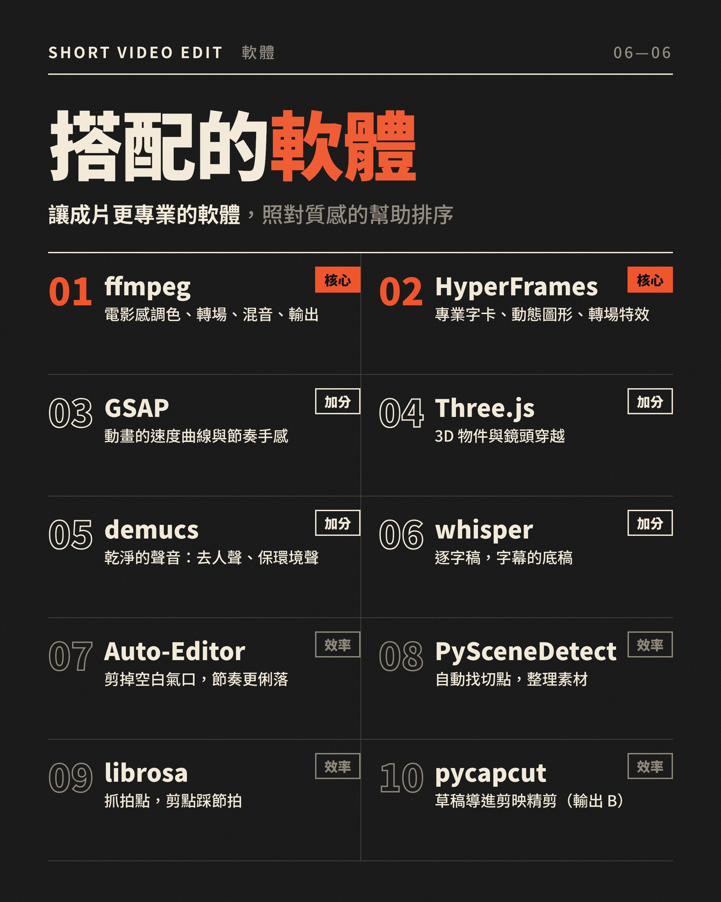
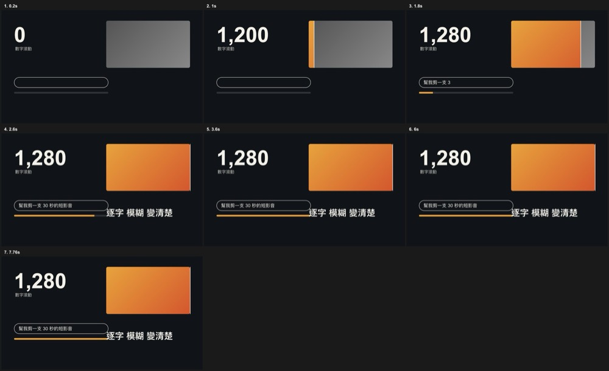
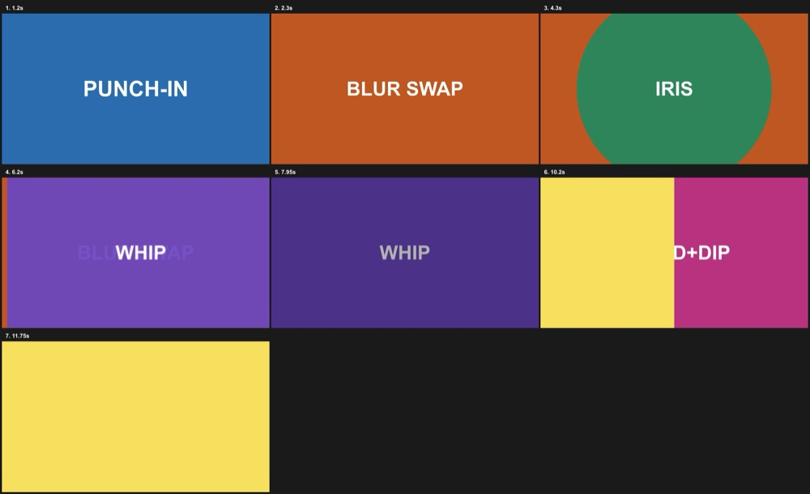
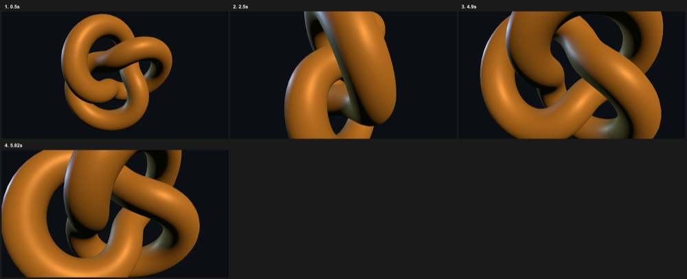

# editing-bay　剪輯機房

把你的 AI agent 變成會剪短影音的好幫手。
*An agent skill that gives your AI agent a clear, step-by-step way to edit short videos.*

<p>
  <a href="https://github.com/josenjc9/editing-bay/stargazers"></a>
  <a href="LICENSE"></a>
  <a href="https://github.com/josenjc9/editing-bay/actions/workflows/ci.yml"></a>
</p>

如果這個 skill 有幫到你，點右上角的 **⭐ Star**，讓更多人找得到。

放進 agent 的 skills 資料夾，對它說一句「幫我剪一支短影音」，它就會照著一套完整流程，從確認需求、排鏡頭、做字卡，到檢查成片、整理交付，一步一步陪你做完。安裝與用法見[使用說明](#使用說明)。

適合：短影音、廣告片、解說片、口播片、預告片混剪、Reels。用你自己的真實素材為主，也能加上動畫與字卡。

**導覽：** [使用說明](#使用說明) · [流程](#流程) · [成品方式](#成品方式由你決定) · [工具與軟體](#工具與軟體) · [驗證](#驗證了什麼沒驗證什麼)

## 使用說明

四步開工：

<p align="center"></p>

### 安裝

```bash
git clone https://github.com/josenjc9/editing-bay.git
mkdir -p ~/.claude/skills
cp -R editing-bay/skill/editing-bay ~/.claude/skills/
```

Claude Code 的 skills 資料夾是 `~/.claude/skills/`；其他 agent 的路徑請查它的說明。放好後對它說「幫我剪一支短影音」。

**不用 git？** 用 GitHub 頁面右上角的 **Code → Download ZIP**，解壓縮後把 `skill/editing-bay` 資料夾放進 agent 的 skills 資料夾就行。

### 需要什麼

看你要做哪條路線，裝對應的東西就好：

| 你要做 | 需要 |
|---|---|
| 基本剪輯、機檢、輸出 A（成品 mp4） | `ffmpeg`（含 `ffprobe`）、`python3` |
| 字卡與動畫 | 上面那些，加 [HyperFrames](https://hyperframes.heygen.com)（需要 Node.js 22+） |
| 輸出 B（剪映草稿） | 上面那些，加 `pycapcut`（Python 3.9+，會一併裝 `pymediainfo`、`imageio`、`numpy`、`Pillow`），以及剪映 App 本身才能開草稿 |
| 成片文字對稿 | macOS 與 `swiftc`（`ocr_check.py`） |
| 口播片、音源與切點 | 依 `SKILL.md` 另外裝：去人聲、語音轉文字、剪氣口、找切點、抓拍點 |

兩個輸出可以任選，也可以都要；選了輸出 B 才需要裝 `pycapcut`。`pycapcut` 在乾淨的 Python 3.9 虛擬環境裡 `pip install pycapcut==0.0.4` 後，範例時間表能寫出草稿（2026-11-11 實測）；它帶進來的 Pillow 等套件請自己檢查版本與安全公告。**裝任何工具前請先確認來源與授權。**

### 你說一句，agent 做一段

不用背流程，照 [PROMPTS.md](PROMPTS.md) 的順序貼句子就行。常用的幾句：

| 你說 | agent 會做 |
|---|---|
| 「幫我剪一支短影音，素材在 ＜資料夾＞」 | 盤點素材做接觸表，列出要你決定的事，停下來等你 |
| 「要電影感預告片」 | 先問情緒（激勵、溫情、懸疑），給三種字卡玩法的 5 秒比較片 |
| 「剪我講話的影片，上字幕」 | 人聲分離、逐字稿對時間、字幕規格自查，字幕不比講的少字 |
| 「介紹這個軟體，這是我錄的畫面」 | 取段前量逐格差異、框與運鏡的節奏規則、字卡固定位置 |
| 「第 12 秒那個框是什麼意思」 | 用截圖找出是哪支素材第幾秒，只改那一處 |
| 「可以了，結案」 | 定稿、清理、覆盤、整理交付資料夾 |

每次停下來，agent 回覆的最後兩行固定是「停在哪、請看什麼／請回什麼」，你不用讀長文。

## 流程

每個關口都停下來問你，你批准才往下走；想一次做完，說「全授權，不用停」。

<p align="center"></p>

- **先對齊，再動手**：agent 會在幾個關鍵點停下來，請你確認事實、風格和鏡頭表。你批准的版本，就是它往下做的依據。
- **做完會自己先看一輪**：解析度、爆音、黑畫面、字幕有沒有壓到臉，先由工具和檢查表篩過一遍，再交給你。
- **做不到的，會直接告訴你**：沒驗證過的做法會標明，不會把嘗試說成保證。
- **每一次都留得下來**：交付資料夾、分鏡板、原始碼、覆盤都有固定位置，下一支片可以接著用。

## 成品方式由你決定

前面的確認關卡都一樣，做完之後怎麼收，每次由你選：

- **直接輸出 mp4**：渲染、機檢、逐張看圖，交付成片。
- **導進剪映**：產出分軌草稿（畫面、字卡、配樂、音效各自一軌），直接導入剪映使用。骨架先剪好，修完你還可以自己精剪，最後加上你的點綴與靈魂。
- **我全都要**：同時出成品與專案草稿。

<p align="center"></p>
<p align="center"></p>

試試看（不需要安裝任何東西）：`python3 skill/editing-bay/tools/capcut_export.py examples/capcut-export-sample/spec.json --dry-run`。要真的寫草稿，先自己安裝 `pycapcut`（裝前請確認來源與授權），再拿掉 `--dry-run`。上圖是這個工具產出的 58.9 秒草稿在剪映裡開起來的時間軸（實際截圖）。範例時間表是 7 秒：2 段畫面、2 張字卡、1 首配樂、2 個音效。畫面片段可加 `look`（亮度／對比／飽和）與 `filter`（濾鏡名稱與強度）。草稿只放素材、時間、簡單調光與濾鏡，**遮罩聚焦、定位框、自製調色不在草稿裡**，要的話在剪映自己補；開起來的樣子也請你自己在剪映確認。圖的 HTML 原始碼在 `docs/src/`。

## 工具與軟體

<p align="center"></p>
<p align="center"></p>

### 裡面有什麼

| 位置 | 內容 |
|---|---|
| `skill/editing-bay/SKILL.md` | agent 讀的主文件：從前期到結案的完整流程與規矩 |
| `skill/editing-bay/references/` | 14 份參考：剪輯語法、跨鏡頭連續性、聲畫與調色、退件格式、**技法庫**（畫中畫、蒙太奇、變速…）、**轉場指南**、**動態圖形與 3D**、技法與工具目錄，以及 6 種情境的做法（口播、預告片、時間流逝、角色動畫、圖卡轉動態、螢幕錄影產品展示） |
| `skill/editing-bay/tools/` | 9 個小工具：成片機檢、切點接觸圖、分鏡板、截圖找出處、字卡地雷掃描、文字比對、交付、安全移垃圾桶、剪映草稿輸出 |
| `examples/` | 3 個可直接渲染的 HyperFrames 範例：動態圖形技法、轉場、Three.js 3D |
| `tests/smoke.sh` | 煙霧測試：用合成影片跑 tools 與文件裡的 ffmpeg 指令（含 58 種 `xfade` 轉場） |


### 範例畫面（都是用 `examples/` 的原始碼渲染、逐格看過的結果）

| 動態圖形技法 | 轉場 | Three.js 3D |
|---|---|---|
|  |  |  |

數字滾動、前後對比拉桿、打字輸入框加進度條、逐字模糊進場；模糊交換、從點擊處開圈、甩鏡、暗角切、整片換色；Three.js 鏡頭穿越。

## 驗證了什麼、沒驗證什麼

| 項目 | 驗證方式 |
|---|---|
| 9 個工具、技法庫的 ffmpeg 指令、58 種 `xfade` 轉場 | `bash tests/smoke.sh`，25 項全部通過（每次推送由 GitHub Actions 自動跑） |
| 動態圖形、轉場、Three.js 範例 | 用 HyperFrames 渲染，逐格看過畫面；Three.js 同一時間點渲染兩次，截圖雜湊相同 |
| PySceneDetect、Auto-Editor、librosa | 用合成素材驗功能（切點偵測、剪空白、BPM 誤差 2% 內） |
| 用在你的真素材上好不好看 | **沒有**，工具只負責「能算的」，畫面好不好看請用你的眼睛 |

文件裡每個技法都標了狀態（實測／指令已跑過／畫面已驗）。

## 使用提醒

- 流程以你的批准為準，agent 會在關鍵節點停下來和你確認。
- 工具負責能算的部分（解析度、爆音、黑畫面…），畫面好不好看，留給你的眼睛。
- 來源與第三方授權見 [NOTICE.md](NOTICE.md)；方法借鏡了 auto-edit-workspace 與 rea-video 的思路，用自己的寫法重做，沒有複製檔案或模板。
- 授權：MIT。回報問題與資安事項見 [SECURITY.md](SECURITY.md)；版本紀錄見 [CHANGELOG.md](CHANGELOG.md)。

如果這個專案對你有用，歡迎給它一顆 ⭐，也歡迎開 issue 告訴我哪裡不好用。

---

---

## English summary

A self-contained skill (`SKILL.md` + 14 reference docs + 9 small tools) that gives an AI coding agent a gated workflow for editing short videos: confirm goal → script → shot list → inventory and tests → rough cut → build → self-check → deliver. Every gate waits for the user's approval. Includes a technique library (picture-in-picture, montage, speed ramps…), a transitions guide (all 58 ffmpeg `xfade` types run in the smoke test), motion-graphics and 3D (Three.js) notes, three renderable HyperFrames examples, and a smoke-test suite run by CI. Written in Traditional Chinese because the checklists include CJK title-card and subtitle typography rules. Download the ZIP from the Releases page and drop `editing-bay/` into your agent's skills folder. MIT licensed.
